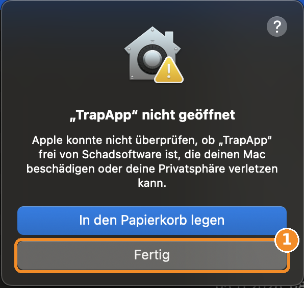
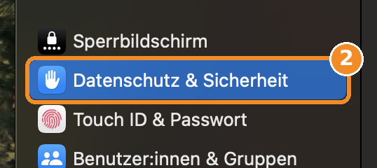
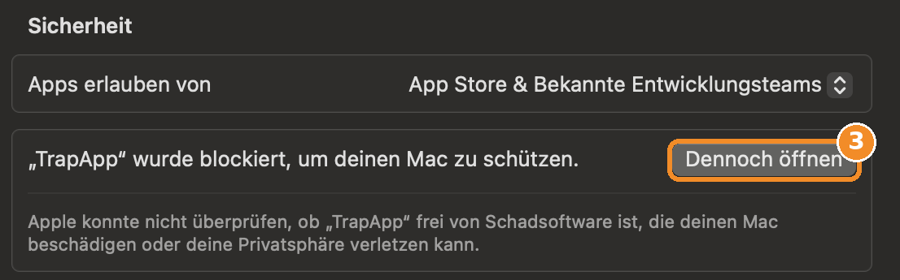
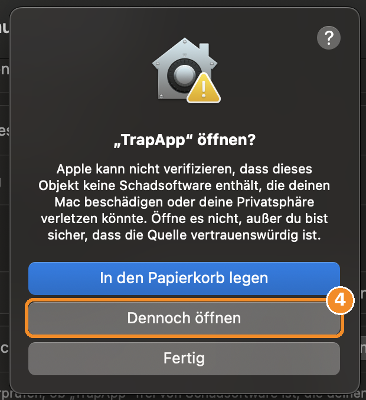
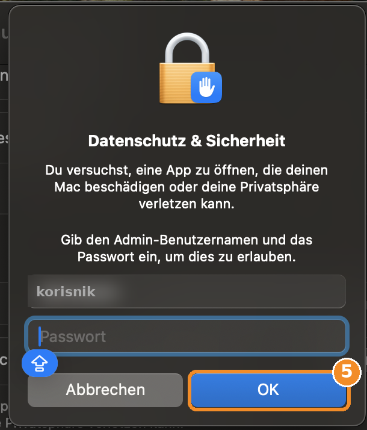
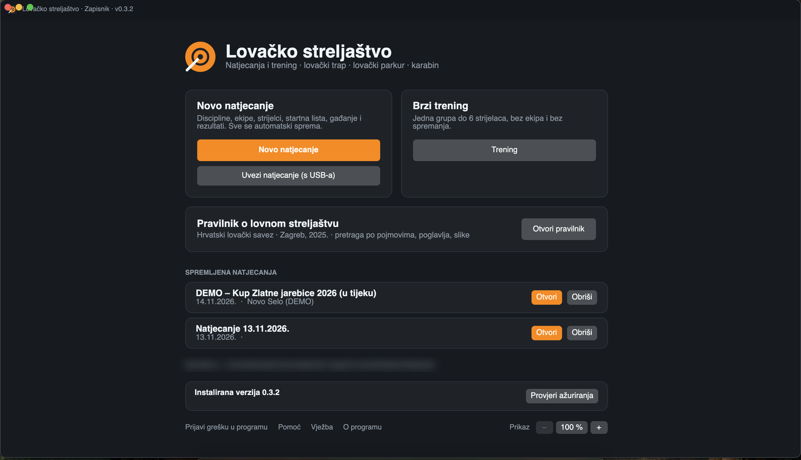

# Lovačko streljaštvo RSBiH – zapisnik (TrapApp-RSBiH)

Program za takmičenja i trening u lovnom streljaštvu po **Pravilniku o lovnom streljaštvu Lovačkog saveza Republike Srpske (LSRS, 2017.)**:
**leteće mete** (trap, 2 × 25 meta, grupa 3, plej-of šest najboljih), **srndać** (nepokretna meta, sa satom i sirenom), **pokretna meta** (vepar ili vuk u trku).
Svaka disciplina se boduje posebno – pojedinačno i ekipno.
Latinica ili **ćirilica** (prekidač „Latinica | Ћирилица“, Ctrl+L).

Za **Windows 10 i 11** i za **Mac** (macOS 14 ili noviji – probna verzija).

> ⚠️ **Probna verzija 0.1.0** – prvo izdanje za Republiku Srpsku. Molimo vas da provjerite da li pravila i bodovanje odgovaraju praksi i javite greške (u programu: početna strana → „Prijavi grešku u programu“).

## ⬇️ Preuzimanje

**[Preuzmi TrapApp-RSBiH-win-Setup.exe](https://github.com/daxemann/trapapp-rsbih-releases/releases/latest/download/TrapApp-RSBiH-win-Setup.exe)** (uvijek najnovija verzija)

Bez instalacije: [TrapApp-RSBiH-win-Portable.zip](https://github.com/daxemann/trapapp-rsbih-releases/releases/latest/download/TrapApp-RSBiH-win-Portable.zip)

Sve verzije i spisak promjena: [Releases](https://github.com/daxemann/trapapp-rsbih-releases/releases)

### 🍎 Mac – probna verzija

| Vaš Mac (jabuka → „O ovom Macu“) | Preuzimanje |
|---|---|
| Čip **Apple M1, M2, M3, M4 …** (skoro svi od 2021.) | **[TrapApp-RSBiH-0.1.0-mac-applesilicon.zip](https://github.com/daxemann/trapapp-rsbih-releases/releases/download/mac-0.1.0-test/TrapApp-RSBiH-0.1.0-mac-applesilicon.zip)** |
| Procesor **Intel** | **[TrapApp-RSBiH-0.1.0-mac-intel.zip](https://github.com/daxemann/trapapp-rsbih-releases/releases/download/mac-0.1.0-test/TrapApp-RSBiH-0.1.0-mac-intel.zip)** |

[Stranica izdanja za Mac](https://github.com/daxemann/trapapp-rsbih-releases/releases/tag/mac-0.1.0-test)

---

## Instalacija (Windows)

1. Preuzmite datoteku **TrapApp-RSBiH-win-Setup.exe** (link gore).
2. Pokrenite je dvostrukim klikom.
3. **Pojaviće se plavi prozor Windowsa** (SmartScreen):

   > **Windows je zaštitio vaš računar** *(njem. „Der Computer wurde durch Windows geschützt“)*

   To je **normalno** i ne znači da je program opasan. Windows ovo prikazuje za svaki program koji nije potpisan skupim komercijalnim sertifikatom.

4. Kliknite na link **„Više informacija“** ispod teksta.
5. Dolje se pojavi dugme **„Ipak pokreni“** – kliknite ga.
6. Instalacija traje nekoliko sekundi, bez dodatnih pitanja i bez administratorskih prava. Program se zatim sam pokrene.

Program se nalazi u meniju **Start** pod nazivom **„Lovacko streljastvo RSBiH“**.

> ℹ️ Plavi prozor se pojavljuje **samo jednom**, kod prve instalacije. Ažuriranja ga više ne prikazuju.

TrapApp-RSBiH je **poseban program** – može da radi pored drugih verzija (TrapApp, TrapApp-SRB) na istom računaru, podaci se ne miješaju.

### Instalacija sa USB fleša

Ako datoteku **TrapApp-RSBiH-win-Setup.exe** kopirate na USB fleš i pokrenete je sa njega na drugom računaru, plavi prozor se po pravilu ne pojavljuje.

### Instalacija na Macu

1. Preuzmite odgovarajuću **.zip** datoteku (tabela gore) i dvaput kliknite na nju → pojavi se **TrapApp-RSBiH**.
2. Prevucite **TrapApp-RSBiH** u fasciklu **Aplikacije / Programi**.
3. **Prvo pokretanje (samo jednom)** – macOS ga blokira jer program nije iz App Storea. To je normalno.

*Slike su sa njemačkog macOS-a – na srpskom ili engleskom dugmad su na istom mjestu.*

| | |
|---|---|
| **1.** Dvaput kliknite na TrapApp-RSBiH → kliknite **„Gotovo“** *(Fertig / Done)* – ne „Premjesti u smeće“. |  |
| **2.** Jabuka → **Podešavanja sistema → Privatnost i sigurnost** *(Datenschutz & Sicherheit / Privacy & Security)*. |  |
| **3.** Dolje kod „Sigurnost“: „TrapApp-RSBiH je blokiran …“ → **„Ipak otvori“** *(Dennoch öffnen / Open Anyway)*. |  |
| **4.** Pitanje „Otvoriti TrapApp-RSBiH?“ → ponovo **„Ipak otvori“**. |  |
| **5.** Lozinka Maca → **OK**. |  |
| **6.** Program se pokrene – od sada normalno dvostrukim klikom. |  |

> ℹ️ „Ipak otvori“ važi **samo za TrapApp-RSBiH** – zaštita Maca za sve ostale programe ostaje uključena.

Ako se pojavi „TrapApp-RSBiH je oštećen“: otvorite Terminal i upišite
`xattr -cr /Applications/TrapApp-RSBiH.app` – zatim ponovo pokrenite.

---

## Šta program radi

- **Leteće mete (trap):** grupa 3 strijelca, 2 × 25 meta (podesivo), automatska promjena mjesta poslije svake mete – sa svakog mjesta po 5 meta u seriji, tasteri Pogodak / Promašaj / Nazad
- **Plej-of:** šest najboljih pojedinaca – 15 meta, zatim po 5, ispada najslabiji; kod jednakog rezultata upisuje se ko je ispao u šut-autu
- **Srndać:** 4–10 hitaca (podesivo), vrijeme po strijelcu – **Start/Stop** (razmak), sirena kad istekne vrijeme, **Sljedeći strijelac** (Enter), prekobrojni hici −2 boda, vrijeme u zapisniku
- **Pokretna meta:** 6 hitaca, krugovi 0–10
- **Ekipe:** 3 strijelca iz iste LU, boduju se sva tri; jednak zbir – odlučuje 1., pa 2., pa 3. strijelac s prijavne liste
- **Pojedinačno:** jednako za 1.–3. mjesto – raspucavanje po jedan hitac; od 4. mjesta mjesta se dijele
- Live monitor (2. ekran/TV), PDF (rezultati, zapisnik, plej-of), razmjena među računarima (USB / mreža), pravilnik LSRS u programu (latinica / ćirilica), vježba sa izmišljenim strijelcima

## Ažuriranja

**Windows:**

- Program kod svakog pokretanja sam provjerava da li postoji nova verzija (potreban je internet).
- Ako postoji, na početnoj strani se pojavi narandžasti okvir **„Dostupna je nova verzija …“**.
- Kliknite **„Preuzmi i ažuriraj“** → program preuzme novu verziju i ponovo se pokrene.
- Dok je takmičenje otvoreno, ažuriranje nije moguće (prvo zatvorite takmičenje).

**Mac:** zasad ručno – preuzmite novu .zip datoteku i zamijenite TrapApp-RSBiH u fascikli Aplikacije. Podaci ostaju sačuvani.

## Podaci

Takmičenja se automatski čuvaju u fascikli:

- **Windows:**

```
%LOCALAPPDATA%\LovackoStreljastvoRSBiH\Takmicenja
```

- **Mac:**

```
~/Library/Application Support/LovackoStreljastvoRSBiH/Takmicenja
```

Podaci **ostaju sačuvani** kod ažuriranja, deinstalacije i ponovne instalacije.

## Deinstalacija

**Windows:** Podešavanja Windowsa → **Aplikacije** → **„Lovacko streljastvo RSBiH“** → **Deinstaliraj**.

**Mac:** prevucite **TrapApp-RSBiH** iz fascikle Aplikacije u Smeće.

---

Autor: Darko Bakić · Pravilnik: Lovački savez Republike Srpske (2017.)
